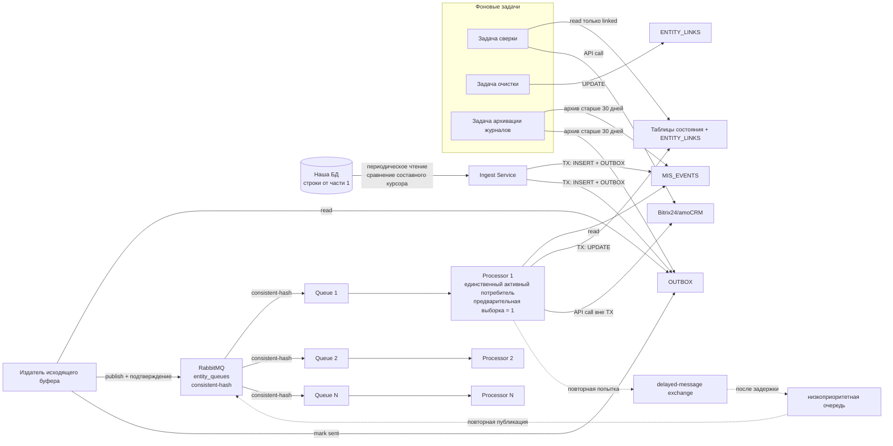
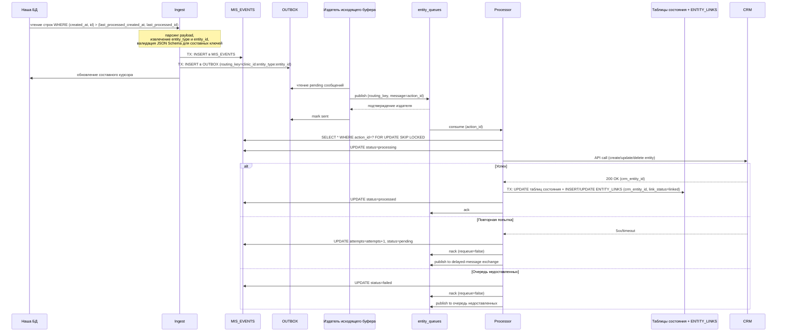

# Интеграция МИС -> CRM: архитектурный разбор

## Исходное тестовое задание (оригинал)

Говорим про интеграцию МИС с amoCRM/Bitrix24.

Сейчас интеграция разделена на две части:
1-я часть - интеграция с МИС как по API, так и установка скриптов на серверах клиник, которые забирают данные напрямую из бд. Отдает унифицированные данные во 2-ю часть.
2-я часть - обработка пришедших данных и загрузка в crm.

Далее речь идет только про 2-ю часть.

**Входные данные:**
От МИС получаем на наш сервер (сейчас это строка в нашей бд содержащая):
- id клиники
- id action (уникальный идентификатор действия)
- тело изменившихся данных в полном виде (например, по пациенту это ФИО, дата рождения, пол, медкарта, дата следующего и прошлого визита)
- action: add/update/delete

**Пример для пациента:** ФИО, дата рождения, пол, медкарта, дата следующего и прошлого визита

**Сущности (как минимум):** услуга, пациент, визит, оплата

**Задача:** С какими основными трудностями столкнёмся при организации загрузки данных в CRM?

**Важно:** Выполнение на 100% невозможно и не ожидается.

---

## Основные трудности и решения

### 1. Обнаружение новых строк и извлечение идентификатора

**Трудность:** Данные уже лежат в нашей БД (часть 1 их туда положила). Нужно обнаружить новые строки, распознать тип сущности и извлечь идентификатор, которого нет в явном виде в payload.

**Решение:**
- **Обнаружение новых строк:** Периодическое чтение нашей БД со сравнением составного курсора как пары (метка времени, id). Таблица `INGEST_CURSOR` хранит составной курсор `(last_processed_created_at, last_processed_id)` по каждой клинике. Каждые 5 секунд выбираем строки по условию `WHERE (created_at, id) > (last_processed_created_at, last_processed_id) ORDER BY created_at, id LIMIT 100`. Это защищает от состояния гонки при пакетных вставках и транзакциях с одинаковой меткой времени.
- **Определение типа сущности:** Предполагаем, что часть 1 добавила поле `entity_type` в строку (требуется уточнение). Если нет — определяем по структуре payload через таблицу правил.
- **Извлечение идентификатора:** Таблица `ENTITY_IDENTIFICATION` хранит правила для каждого типа сущности:
    - Пациент: `medical_card` (медкарта как естественный ключ) + `fio` + `birth_date` для проверки
    - Визит: составной ключ `patient_medical_card + visit_date + service_code`, хранится в `entity_id_json` как JSON с валидацией по JSON Schema (стандарт описания структуры JSON-документов). Пример сериализованного ключа: `{"patient_medical_card": "123", "visit_date": "2024-01-15", "service_code": "A01"}`
    - Услуга: `service_code` или `service_name` (справочник)
    - Оплата: `payment_receipt_number` (номер чека) или `payment_external_id`

То же значение ключа в сериализованном виде лежит в `MIS_EVENTS.entity_id`, поэтому журнал и таблицы состояния ссылаются на один и тот же ключ.

Если в payload отсутствует нужный идентификатор — событие уходит в карантин с алертом "невозможно определить сущность". Производные поля (даты следующего/прошлого визита) в идентификации не участвуют.

### 2. Атомарность: БД и очередь не должны расходиться

**Трудность:** Если мы сохранили событие в БД, но упали до публикации в очередь — событие потеряно. Если опубликовали в очередь, но не сохранили в БД — получаем фантомное сообщение.

**Решение:** Паттерн "исходящий буфер" (transactional outbox):
1. В одной транзакции делаем INSERT в `MIS_EVENTS` и INSERT в `OUTBOX` (сообщение для очереди).
2. Отдельный издатель читает `OUTBOX` и публикует сообщения в RabbitMQ.
3. После получения подтверждения от RabbitMQ (publisher confirms) помечаем строку `OUTBOX` как отправленную.

Если издатель упал после публикации, но до подтверждения — при перезапуске он опубликует повторно. Идемпотентность на уровне `action_id` защитит CRM от дублей записей. Дубли в очереди допустимы, метрика "дубли в очереди" отслеживается для обнаружения проблем.

### 3. Идемпотентность на двух уровнях

**Трудность:** Защита от дублей двух типов:
- Технические дубли (тот же `id action` пришёл дважды)
- Бизнес-дубли (одна оплата пришла дважды с разными `id action`)

**Решение:**
- **Уровень 1 (id action):** Уникальный индекс на `(clinic_id, action_id)` в таблице `MIS_EVENTS`.
- **Уровень 2 (окно дедупликации для оплат):** Таблица `PAYMENT_DEDUP_WINDOW` с полями:
    - `clinic_id`
    - `patient_medical_card` (естественный ключ пациента)
    - `amount` (сумма)
    - `created_at` (время события)

  Перед созданием оплаты проверяем: если за последний час для этого пациента уже была оплата с суммой в пределах ±5% и временем в пределах ±5 минут, блокируем создание, помечаем `requires_review=true`, создаём алерт для ручной проверки.

### 4. Сохранение порядка событий

**Трудность:** События могут приходить в произвольном порядке (update раньше add). RabbitMQ не умеет парсить JSON payload на уровне exchange.

**Решение:**
1. **Ingest парсит payload** и сразу публикует в RabbitMQ exchange `entity_queues` типа consistent-hash (согласованное хеширование — распределение сообщений по очередям на основе хеша routing key) с routing key `clinic_id:entity_type:entity_id`.
2. **Processing:** Consistent-hash exchange распределяет сообщения по N очередям так, что все события одной сущности попадают в одну очередь. Каждая очередь имеет единственного активного потребителя (single active consumer — только один потребитель активен в каждый момент времени), предварительная выборка = 1, обработка строго последовательная.

Если consistent-hash недоступен (нет плагина) — резервный вариант: отдельные очереди на каждую клинику + внутри клиники consistent-hash по `entity_type:entity_id`.

### 5. Обработка ошибок и повторные попытки

**Трудность:** Временные сбои (сеть, CRM недоступна) не должны приводить к потере данных.

**Решение:**
- **Экспоненциальная задержка со случайным разбросом:** Задержка между попытками растёт (1s, 2s, 4s, 8s...) со случайным разбросом (±20%) для предотвращения эффекта толпы.
- **Автоматический выключатель по CRM:** если за окно 5 минут доля ошибок CRM выше 50% — приостанавливаем отправку из буфера и алертим, чтобы не долбить больную систему и не сжигать попытки.
- **Очередь недоставленных сообщений (DLQ):** После N попыток (например, 5) сообщение уходит в DLQ с алертом для ручного разбора.

### 6. Первичная загрузка истории

**Трудность:** При подключении новой клиники нужно загрузить исторические данные без блокировки текущей обработки.

**Решение:**
- **Импорт из CSV:** Выгружаем историю из МИС в CSV, загружаем в CRM через пакетный импорт (обходит ограничения частоты запросов).
- **Параллельная обработка:** Инкрементальная обработка продолжается во время загрузки.
- **Стратегия разрешения конфликтов:** CSV создаёт записи со статусом `csv_imported` (импортирован из CSV) в `ENTITY_LINKS`. Инкремент при обнаружении такой записи выполняет полное обновление (объединение всех полей), а не отклонение. После успешного обновления статус меняется на `linked` (связан).

Если CSV недоступен — используем обычный обработчик (медленнее, но работает).

### 7. Сверка данных

**Трудность:** Со временем данные в МИС и CRM могут расходиться.

**Решение:**
- **Инкрементальная сверка (ежесуточно):** Проверяем только записи, изменившиеся за последние 24 часа:
    1. Читаем записи из таблиц состояния с `updated_at > now() - interval '24 hours'` и `link_status = 'linked'`
    2. Для каждой записи проверяем наличие в CRM по `crm_entity_id` из `ENTITY_LINKS`
    3. Сравниваем поля (суммы, даты, статусы)
    4. Расхождения логируем в отчёт
- **Полная сверка (еженедельно, в выходные):** Раз в неделю проверяем все записи с `link_status = 'linked'`. Это ловит исторический дрейф - старые записи, которые потерялись или были изменены вручную в CRM.
- **Стратифицированная выборка:** Если объём >100k записей (даже для инкрементальной сверки):
    - Минимум 50 записей на клинику (статистически значимо)
    - Принудительная проверка клиник с задержкой обработки > 60s
    - Потолок: не более 1000 проверок за цикл
- **Автоматический выключатель:** Если >50% проверок выявили расхождения — останавливаем сверку, алерт.
- **Таймаут:** 23 часа для инкрементальной, 47 часов для полной (если не уложилась — алерт и принудительное завершение).

### 8. Обработка незавершённых записей

**Трудность:** При сбое во время создания записи в CRM может остаться "незавершённая" запись (статус `creating` — создаётся).

**Решение:**
- **Срок действия метки аренды (lease_expires_at — время истечения аренды):** При создании ставим метку аренды (now() + 5 минут).
- **Процесс очистки:** Каждые 30 секунд ищем записи со статусом `creating` и истёкшей меткой.
- **Судьба записи:** связанные записи ищем по внешним ключам в таблицах состояния: оплаты и визиты, ссылающиеся на пациента, и оплаты, ссылающиеся на визит.
    - Если срок истёк и связанных записей нет — удаляем связь с логированием причины
    - Если связанные записи есть — помечаем как `orphan` (сирота) для ручного разбора
- **SLA:** Оповещение дежурному инженеру, реакция в течение 4 часов.

### 9. Управление конфигурацией

**Трудность:** Для каждой клиники свои настройки (CRM-система, маппинг полей, ограничения частоты запросов).

**Решение:**
- **Таблица конфигурации:** `CLINICS` хранит настройки (crm_type, rate_limit, field_mapping).
- **Кэш:** Настройки кэшируются в памяти (TTL 5 минут). При изменении — сброс кэша через Redis pub/sub.
- **Резервный вариант для Redis:** Если Redis недоступен, кэш сбрасывается по TTL. Кнопка ручного сброса в админке.
- **RBAC (управление доступом на основе ролей):** Доступ к админке ограничен ролью `admin`.

### 10. Обработка ручных правок в CRM

**Трудность:** Пользователь может вручную изменить данные в CRM. При следующей синхронизации МИС перезапишет эти правки.

**Решение:**
- **Таблица принадлежности полей:** `FIELD_OWNERSHIP` определяет, какие поля принадлежат МИС (перезаписываются), а какие — CRM (не перезаписываются).
- **Консервативная стратегия (по умолчанию):** Все поля принадлежат МИС. Ручные правки в CRM запрещены до согласования с бизнесом.
- **Миграция при согласовании:**
    1. Сравниваем текущее значение в МИС с историей ручных правок в CRM (если CRM хранит аудит).
    2. Если CRM не хранит аудит, используем метку времени последнего изменения (более позднее побеждает).
    3. Конфликтующие записи помечаем для ручного разбора.

### 11. Производные поля в payload

**Трудность:** В примере payload для пациента упомянуты "дата следующего и прошлого визита" — это производные поля, которые меняются при каждом изменении визита.

**Решение:**
- **Не храним производные поля** в таблицах состояния как авторитетные данные.
- **При обновлении пациента** игнорируем эти поля в payload.
- **В CRM передаём производные даты** как срез на момент синхронизации (вычисляем из таблицы визитов).

---

## Модель данных (ER-диаграмма)

```mermaid
erDiagram
    CLINICS ||--o{ MIS_EVENTS : "имеет"
    CLINICS ||--o{ ENTITY_LINKS : "имеет"
    CLINICS ||--o{ FIELD_OWNERSHIP : "имеет"
    CLINICS ||--o{ PAYMENT_DEDUP_WINDOW : "имеет"
    CLINICS ||--o{ ENTITY_IDENTIFICATION : "имеет"
    CLINICS ||--o{ INGEST_CURSOR : "имеет"
    CLINICS ||--o{ OUTBOX : "имеет"
    CLINICS ||--o{ PATIENTS : "имеет"
    CLINICS ||--o{ VISITS : "имеет"
    CLINICS ||--o{ SERVICES : "имеет"
    CLINICS ||--o{ PAYMENTS : "имеет"

    CLINICS {
        bigint id PK
        string name
        string crm_type "bitrix24|amocrm"
        int rate_limit
        jsonb field_mapping
        timestamp created_at
        timestamp updated_at
    }

    INGEST_CURSOR {
        bigint id PK
        bigint clinic_id FK
        timestamp last_processed_created_at "составной курсор: метка времени"
        bigint last_processed_id "составной курсор: id"
        timestamp updated_at
    }

    MIS_EVENTS {
        bigint id PK
        bigint clinic_id FK
        string action_id UK "уникальный id действия из ТЗ"
        jsonb payload "тело из ТЗ"
        string entity_type "извлечён из payload"
        string entity_id "тот же ключ что в таблицах состояния, сериализованный"
        string action "add|update|delete"
        string status "pending|processing|processed|failed"
        int attempts
        timestamp created_at
        timestamp processed_at
    }

    OUTBOX {
        bigint id PK
        bigint clinic_id FK
        bigint event_id FK
        string routing_key "clinic_id:entity_type:entity_id"
        string status "pending|sent"
        timestamp created_at
        timestamp sent_at
    }

    ENTITY_LINKS {
        bigint id PK
        bigint clinic_id FK
        string entity_type
        string entity_id "извлечён по правилам"
        string crm_entity_id
        string link_status "creating|csv_imported|linked|orphan"
        timestamp lease_expires_at "время истечения аренды"
        timestamp created_at
        timestamp updated_at
    }

    FIELD_OWNERSHIP {
        bigint id PK
        bigint clinic_id FK
        string entity_type
        string field_name
        string owner "mis|crm"
        timestamp created_at
        timestamp updated_at
    }

    PAYMENT_DEDUP_WINDOW {
        bigint id PK
        bigint clinic_id FK
        string patient_medical_card "естественный ключ"
        numeric amount "сумма оплаты"
        timestamp created_at "время события"
        boolean requires_review
    }

    ENTITY_IDENTIFICATION {
        bigint id PK
        bigint clinic_id FK
        string entity_type
        jsonb identification_rules "правила извлечения entity_id"
        jsonb validation_schema "JSON Schema для валидации"
        timestamp created_at
        timestamp updated_at
    }

    PATIENTS {
        bigint id PK
        bigint clinic_id FK
        string medical_card UK "естественный ключ"
        string fio
        date birth_date
        string gender
        timestamp created_at
        timestamp updated_at
    }

    VISITS {
        bigint id PK
        bigint clinic_id FK
        bigint patient_id FK
        jsonb entity_id_json "составной ключ с валидацией"
        timestamp visit_date
        string status
        timestamp created_at
        timestamp updated_at
    }

    SERVICES {
        bigint id PK
        bigint clinic_id FK
        string service_code UK
        string name
        numeric price
        timestamp created_at
        timestamp updated_at
    }

    PAYMENTS {
        bigint id PK
        bigint clinic_id FK
        bigint patient_id FK
        bigint visit_id FK
        string payment_receipt_number UK "номер чека"
        numeric amount
        timestamp payment_date
        string status
        timestamp created_at
        timestamp updated_at
    }
```

---

## Архитектура компонентов

---

## Жизненный цикл события

---

## Резервные варианты

**Consistent-hash exchange требует плагина RabbitMQ.** Если плагин недоступен:
- Отдельные очереди на каждую клинику с прямым роутингом
- Внутри клиники consistent-hash по `entity_type:entity_id`
- Задержки через отдельные очереди на каждый шаг (30 сек, 1 мин, 5 мин) с TTL и резервным exchange обратно в основную очередь

**Redis недоступен для кэша настроек:**
- Кэш сбрасывается по TTL (каждые 5 минут)
- Кнопка ручного сброса в админке

**Импорт из CSV недоступен для первичной загрузки:**
- Используем обычный обработчик событий (медленнее, но работает)

**Часть 1 не добавляет entity_type в строку:**
- Определяем тип сущности по структуре payload через таблицу правил `ENTITY_IDENTIFICATION`
- Риск: неоднозначное определение для некоторых payload

---

## Мониторинг, оповещения и хранение журналов

**Метрики:** задержка обработки (разница между текущим моментом и created_at события), размер очередей по клиникам, дубли в очереди, доля ошибок CRM за окно 5 минут, расхождения сверки за последний цикл.

**Оповещения:** дежурному инженеру в мессенджер или на почту: очередь больше 1000 сообщений дольше 10 минут, доля ошибок CRM выше 50%, сверка остановлена выключателем, запись в карантине старше суток.

**Хранение журналов:** обработанные строки `MIS_EVENTS` и отправленные строки `OUTBOX` архивируем через 30 дней и удаляем через 90; сроки настраиваются на клинику.

**Секреты и логи:** токены CRM и пароли Redis хранятся вне репозитория; каждое событие логируется со сквозным идентификатором, чтобы восстановить путь от строки МИС до вызова CRM.

---

## Вопросы для уточнения

1. **Объём исторических данных:** Какой объём нужно загрузить при подключении новой клиники? (10k, 100k, 1M записей)
2. **SLA для обработки:** Какой SLA для обработки событий? (99% за 1 минуту, 99.9% за 5 минут)
3. **Мониторинг:** Какие системы мониторинга используются? (Prometheus, Datadog)
4. **Deployment:** Как развёртывается сервис? (Kubernetes, Docker Compose)
5. **Метаданные от части 1:** Добавляет ли часть 1 поле `entity_type` в строку, которую кладёт в нашу БД? Или мы должны определять тип сущности по структуре payload?
6. **Медкарта как ключ пациента:** Корректно ли использовать номер медкарты как естественный ключ для пациента, или есть более стабильный идентификатор?
7. **Идентификаторы для других сущностей:** Какие поля в payload являются идентификаторами для визита, услуги, оплаты?
8. **Уникальность id action:** Гарантирует ли МИС, что `id action` уникален в рамках клиники навсегда, или возможны повторные использования?

---

## Заключение

Основные трудности интеграции (в контексте оригинального ТЗ):

1. **Обнаружение новых строк и извлечение идентификатора** — сравнение составного курсора (метка времени, id) для защиты от состояния гонки, таблица `ENTITY_IDENTIFICATION` с правилами и JSON Schema валидацией для каждого типа сущности, медкарта как естественный ключ для пациента
2. **Атомарность между БД и очередью** — паттерн "исходящий буфер" (transactional outbox) + подтверждения издателя от RabbitMQ
3. **Идемпотентность** — двухуровневая защита (action_id + окно дедупликации с нечётким сравнением по полям)
4. **Порядок событий** — consistent-hash exchange (согласованное хеширование) на извлечённых entity_type:entity_id, единственные активные потребители с предварительной выборкой = 1
5. **Обработка ошибок** — экспоненциальная задержка + разброс + автоматический выключатель по ошибкам CRM + очередь недоставленных сообщений
6. **Первичная загрузка** — импорт из CSV + параллельная обработка + стратегия разрешения конфликтов
7. **Сверка данных** — инкрементальная сверка (ежесуточно, по updated_at) + полная сверка (еженедельно) по таблицам состояния с `link_status = 'linked'` (связан) + проверка по crm_entity_id + стратифицированная выборка с минимумом 50 записей + автоматический выключатель + таймаут
8. **Незавершённые записи** — срок аренды (lease_expires_at) + процесс очистки + проверка связанных записей по внешним ключам + SLA
9. **Конфигурация** — таблица настроек + кэш + резервный вариант для Redis + RBAC (управление доступом на основе ролей)
10. **Ручные правки** — таблица принадлежности полей + консервативная стратегия + миграция
11. **Производные поля** — не храним как авторитетные, вычисляем из таблицы визитов

Все решения строго соответствуют оригинальному ТЗ:
- Читаем из **нашей БД** (куда часть 1 положила данные), а не опрашиваем БД МИС
- Атомарность обеспечена паттерном outbox + подтверждения издателя + транзакционное обновление таблиц состояния и ENTITY_LINKS
- Извлекаем идентификаторы из payload по правилам с JSON Schema валидацией
- Сравнение составного курсора защищает от состояния гонки
- Сверка работает только по синхронизированным записям (`link_status = 'linked'`) и ищет их в CRM по crm_entity_id

---

## Как проверим, что это работает

Без этого раздела всё выше - декларация. Минимальный набор на стенде с песочницей CRM:

1. Идемпотентность: одно событие отправляем 100 раз - в CRM одна запись.
2. Исходящий буфер: убиваем издателя между публикацией и отметкой sent - дублей в CRM нет, сообщение доставлено после перезапуска.
3. Порядок: update приходит раньше add, старое событие после нового - конечное состояние корректное.
4. Частичный отказ пакета: половина строк с ошибкой - буфер размечен построчно, успешные не повторяются.
5. Родитель-сирота: оплата без пациента - связь остаётся в статусе creating, после прихода события родителя обработка завершается и статус становится linked.
6. Срок аренды: запись creating с истёкшей меткой - сброшена или помечена сиротой, оповещение ушло.
7. Сверка: вносим расхождение вручную - сверка находит его и кладёт в отчёт.
8. Нагрузка: пиковый объём клиники, умноженный на два - задержка обработки не выше 60 секунд.