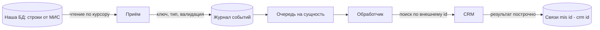

# Интеграция МИС -> CRM: что сломается и что с этим делать

## Задание

От МИС приходит строка в нашей БД: id клиники, id действия, тело изменившихся данных целиком, действие add/update/delete. Сущности как минимум: услуга, пациент, визит, оплата. Вопрос: с какими основными трудностями столкнёмся при загрузке этих данных в CRM.

## Ответ

Пункты идут от того, что бьёт по деньгам, к тому, что бьёт по нервам.

**1. События приходят дважды, а оплаты это деньги.**
Доставка минимум один раз значит иногда два. Повторная оплата создаст вторую запись в CRM, и это финансовый инцидент, а не баг. Защита от дублей живёт до CRM: уникальный ключ на id действия на входе, а для оплат дополнительно окно по пациенту, сумме и времени, потому что МИС может прислать тот же факт с новым id действия.

**2. В теле нет явного id сущности.**
В примере ТЗ у пациента поля: ФИО, дата рождения, пол, медкарта, даты визитов. Поля id нет. Значит ключ выбираем сами: для пациента медкарта, для визита связка пациент + дата + услуга, для оплаты номер чека. Правила держим в одном месте; если в теле ключа нет, событие уходит в разбор, а не угадывается.

**3. Порядок не гарантирован, родители опаздывают.**
Обновление может приехать раньше создания, оплата раньше пациента. События одной сущности ведём в одну очередь и обрабатываем по одной. Дочернее без родителя не создаём половинчатым: откладываем и ждём родителя.

**4. У CRM нет операции создать-или-обновить.**
Перед созданием ищем запись по внешнему id, который сами же кладём в поле CRM. Без этого поля искать не по чему, поэтому оно заводится до первой загрузки, вместе с воронками и товарами под услуги.

**5. В CRM уже есть люди, и это ломает первичную загрузку.**
Залить историю пакетом вслепую нельзя: часть пациентов менеджеры завели руками. Сначала выгружаем из CRM существующие записи по внешнему id и делим на две корзины: кого нет, того пакетом создаём, кто есть, того пакетом обновляем. Инкремент включаем после, иначе окно перекрытия наплодит дублей.

**6. Менеджер правит телефон, МИС перетирает.**
Без договорённости чьи поля чьи получим войну записей: каждое событие МИС будет затирать ручные правки. По умолчанию медицинские факты и медкарта за МИС, телефон и коммуникации за CRM; список согласуем до старта.

**7. Возврат и аванс не помещаются в схему оплата закрыла сделку.**
Возврат это отдельная операция, а не удаление оплаты. Аванс приходит без счёта, наличные без документа. Храним оплату как факт с типом и знаком, а статус сделки считаем по совокупности, а не по одной записи.

**8. Удаление в МИС не равно удалению в CRM.**
Физическое удаление рвёт историю и плохо совместимо с персональными данными. Помечаем запись удалённой, срок и процедуру обезличивания отдаём бизнесу: это их решение, не наше.

**9. Лимиты CRM и грязные данные съедают часы.**
У Bitrix24 по документации около двух запросов в секунду, значит история большой клиники грузится часами, а не минутами. Отдельный процесс на историю, ограничение частоты на клинику в инкременте. Часовые пояса клиник, форматы дат и пустые обязательные поля нормализуем на входе; заглушки вместо данных не подставляем.

## Что спрошу до старта

1. Есть ли в строке тип сущности, или угадывать по телу.
2. Что считать ключом пациента и есть ли стабильный id вместо медкарты.
3. Какие поля в CRM обязательны и что уже заведено: воронки, товары, поле под внешний id.
4. Есть ли выгрузка истории из МИС файлом, или только поток событий.
5. Удаление из МИС это ошибка оператора или отзыв согласия: от этого зависит срок хранения.

## С чего начну

Со входной таблицы: статус, счётчик попыток, уникальный ключ на id действия. Это несколько дней работы, после которых дубли и потери перестают быть невидимыми. Дальше новый пайплайн растёт рядом со старым, старые обработчики отключаем по мере покрытия, без переписывания разом.

## Схема потока

## Черновик и работа над ошибками

Первая версия ответа получилась в разы длиннее и ушла в спецификацию: схемы, таймауты, мониторинг, резервные варианты. Часть цифр была примерами без пометки, а в первичной загрузке я пропустил проверку уже существующих в CRM записей. Черновик и разбор ошибок оставил как есть в истории коммитов.